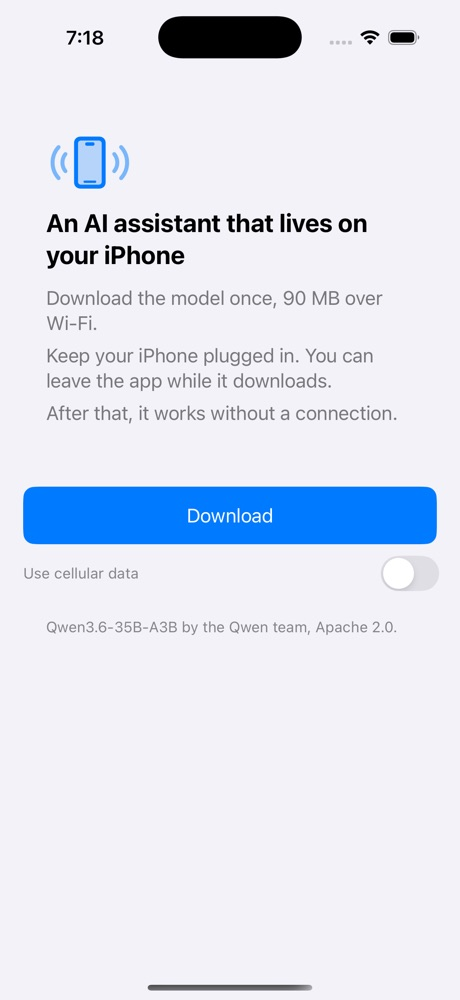
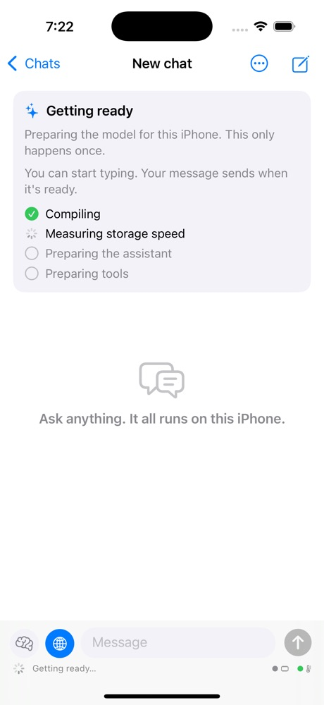
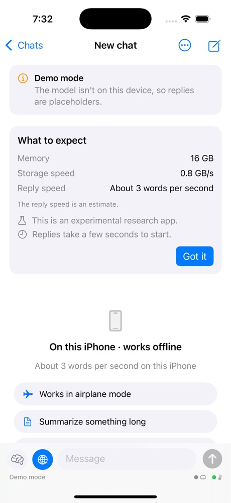

# Qwen3.6-35B-A3B on an iPhone, experts read from flash

An iPhone app that runs [Qwen/Qwen3.6-35B-A3B](https://huggingface.co/Qwen/Qwen3.6-35B-A3B), a 35B-parameter
mixture-of-experts model, entirely on the phone. On an iPhone 15 Plus (6 GB of RAM) it decodes at 3.7 to 3.9
tokens/s with about 3.0 to 3.1 GB of app memory. The 10,240 routed experts stay on flash as 4-bit records (15.7 GB
losslessly compressed, 18.1 GB raw) and are chosen four layers early and read ahead while the layers in between
compute. In memory: 1.10 GB of 4-bit weights, 0.33 GB of 8-bit routers and the expert slots the phone's memory
allows.

Weights: [jalenluorion/phone-store-qwen36-35b-a3b](https://huggingface.co/jalenluorion/phone-store-qwen36-35b-a3b)
on Hugging Face. The app downloads them itself on first launch (18.2 GB over Wi-Fi).

<p>



</p>

*Simulator screenshots of the first run. The model cannot run in the simulator, so they show a 90 MB stand-in
download and the app's demo mode; on a phone the download is 18 GB and the memory row shows the phone's.*

The released model is unchanged except for 4-bit quantization. The only trained part is a small router per layer
that names each layer's experts four layers before that layer runs; the released router still makes the final choice
among the experts that are in memory. One phone has been measured, the iPhone 15 Plus.

## Install on your iPhone

### What you need

- **A Mac with Xcode 26** from the App Store (built and tested with Xcode 26.3 on macOS 26.5.1). Open Xcode once
  after installing it and let it install the iOS platform when it offers to. Xcode 26 also needs its Metal toolchain,
  a separate download of about 700 MB; `setup.sh` below offers to fetch it.
- **An Apple ID.** A free one works: Xcode makes a "Personal Team" for it. With a free Apple ID the app runs for
  7 days, then has to be installed again from Xcode (one click, your chats and the model stay). A paid Apple
  Developer Program membership makes it last a year.
- **An iPhone with 6 GB of memory or more, on iOS 26 or later.** The app checks the memory itself before it offers
  the download and says so if the phone has too little. Only an iPhone 15 Plus (6 GB, iOS 27.2) has been measured.
- **About 21 GB free on the iPhone**: 18.2 GB for the model, 1 GB the download keeps spare, and up to 1.5 GB the app
  uses to save chat progress.
- **Wi-Fi** for the download, and a USB cable for the first install.

### Steps

1. Get the code. In Terminal:

   ```bash
   git clone https://github.com/jalenluorion/Qwen3.6-35B-A3B-moved-store
   cd Qwen3.6-35B-A3B-moved-store
   ./setup.sh
   ```

   `setup.sh` checks Xcode and the Metal toolchain, finds your team in Xcode > Settings > Accounts (add your Apple
   ID there first), and asks for one word, such as your name, to make a bundle id that is yours
   (`com.<word>.phonestore`). It writes them to `ios/PhoneStoreApp/Local.xcconfig`, which git ignores.

   Without the script: open the project in Xcode, select the PhoneStoreApp target, open Signing & Capabilities,
   choose your team, and change the Bundle Identifier to something of your own, such as `com.yourname.phonestore`.
   A bundle id belongs to the first team that registers it, so the example id will not work for you.

2. Open `ios/PhoneStoreApp/PhoneStoreApp.xcodeproj` in Xcode.

3. Connect the iPhone with the cable, unlock it and tap Trust if it asks. Turn on Developer Mode: on the iPhone,
   Settings > Privacy & Security > Developer Mode (the switch appears after the phone has been connected to Xcode
   once), then restart the phone and confirm.

4. In Xcode, choose your iPhone at the top of the window and press Run (the triangle). The first build fetches a
   few Swift packages from GitHub and compiles the model's GPU kernels; it took 2 min 46 s on an M4 MacBook Pro
   ([results/build](results/build/clean_clone_build_2026-11-17.txt)). The scheme builds the fast Release
   configuration.

5. The first time, iOS refuses to open an app from a new developer. On the iPhone: Settings > General > VPN & Device
   Management > your Apple ID > Trust. Then open PhoneStore from the home screen.

### What the first launch looks like

1. **Download.** One screen with a Download button. The app fetches the model from Hugging Face in the background:
   you can leave the app or lock the phone, and it continues after a lost connection or a restart of the app. Keep
   the phone plugged in. Every file is checked against its published SHA-256 before it is used. On our Wi-Fi the
   phone downloaded at 11.4 MB/s in one test and 36.5 MB/s in another (15.7 GB in 430 s,
   [results/phone/download](results/phone/download)), so the 18.2 GB take roughly 8 to 27 minutes, depending on
   your network.
2. **Getting ready.** When the last file is checked the chat opens with a "Getting ready" card: the GPU kernels are
   compiled, the storage speed is measured and the assistant's instructions are read and saved. This happens once
   per install. Measured: 16.1 s and 17.5 s when some of it was already saved; about 43 s when nothing is, by the sum of its measured steps
   ([results/phone/launch](results/phone/launch), [results/phone/setup](results/phone/setup)). You can type during
   it; the message is sent when it finishes.
3. **What to expect.** A card shows the phone's memory, its measured storage speed and an estimate of the reply
   speed. Then the chat is ready. Every later launch opens the chat at once and loads the model in the background in
   about 3.5 s.

### Updating, reinstalling, removing

- **Update**: `git pull`, then Run again in Xcode. The new build installs over the old one; the model and your chats
  stay.
- **After 7 days** (free Apple ID) the app no longer opens. Connect the phone and press Run in Xcode again.
- **Delete the model**: in the app, Settings > Model > Delete model frees about 18.2 GB; your chats are kept and the
  app offers the download again. Deleting the app from the home screen removes everything.

### Troubleshooting

- *"Failed to register bundle identifier"* or *"cannot be registered to your development team"*: the bundle id is
  taken. Run `./setup.sh` again with another word, or change it in Signing & Capabilities.
- *"Untrusted Developer"* when opening the app: trust your Apple ID in Settings > General > VPN & Device Management.
- *Xcode says Developer Mode is disabled*: turn it on in Settings > Privacy & Security > Developer Mode and restart
  the phone.
- *"cannot execute tool 'metal' due to missing Metal Toolchain"*: run `xcodebuild -downloadComponent MetalToolchain`
  once.
- *"iOS 26.x is not installed. Please download and install the platform from Xcode > Settings > Components"*:
  install the iOS platform there (or `xcodebuild -downloadPlatform iOS`).
- *"invalid code signature"* or *"not trusted"* right after an install: we saw this once; launching again two minutes
  later worked. If it stays, Product > Clean Build Folder in Xcode and Run again.
- *The app stopped opening after a week*: the free signing expired; Run from Xcode again.
- *"Not enough storage"*: the screen says how much is needed (19.2 GB including the spare 1 GB). Free space in
  Settings > General > iPhone Storage; the download continues by itself.
- *"This iPhone doesn't have enough memory to run the model"*: the phone gives the app too little memory to hold the
  model's in-memory part plus 8 expert slots per layer. There is no workaround.
- *Packages fail to resolve on the first build*: the Mac needs internet access to GitHub for that build.

## Using the app

- **Chats.** Start a new chat with the compose button; chats are kept on the phone and listed under Chats. A message
  can be edited and sent again; a chat can be copied or shared as Markdown, and Settings > Your chats exports all of
  them.
- **Thinking.** The brain button turns the model's thinking on or off for a chat (off by default). Thinking replies
  take longer.
- **Web search.** The globe button lets the model search the web when a question needs current facts (on by
  default). Searched answers show their sources as numbered chips that open the page. DuckDuckGo needs no key; Brave
  or Tavily can be chosen in Settings with your own key, which is kept in the Keychain.
- **Custom instructions.** Settings > Chat > Custom instructions: "About you" and "How to answer", used by new
  chats.
- **Status dots** under the message box: memory (green plenty, yellow getting low, red iOS may close the app soon)
  and temperature (green normal, yellow warm, orange hot so replies slow down, red let the phone cool).
- **Reply caption**, such as "3.8 tokens/s · started in 6.6 s": the decode speed of that reply and the time from
  sending to its first word. Tap it for the details: length, time spent thinking, how much was reused from saved
  progress, and how much was read from storage.
- **Send feedback**: Settings > Send feedback prepares a zip of the app's logs and settings for the share sheet.
  It never includes the model or your search keys; chats only if you tick "Include my chats".

## On the phone

**Memory.** At launch the app reads how much memory iOS will give it and sizes the expert slots to fit, keeping a
1.2 GB margin under iOS's limit: slots per layer =
(available − 1.10 GB weights − 0.34 GB routers − 0.15 GB state − 0.04 GB decoding buffer − 1.2 GB) / (43 × 1.77 MB).
The app is signed with Apple's increased-memory-limit entitlement, which a free Personal Team accepts; on the
15 Plus it raised the memory iOS gives the app from 3.20 to 4.28 GB
([results/phone/memory_limit](results/phone/memory_limit)).

| phone RAM | memory for the app | slots per layer | status |
|---|---|---|---|
| 6 GB (iPhone 15 Plus) | 4.27 GB | 18 (720 in total, 1.27 GB) | measured: app footprint 2.9 to 3.1 GB |
| 8 GB | about 5.7 GB if iOS gives the same 72% share as on the 15 Plus | about 38 | computed, not run |
| 12 GB | about 8.6 GB at the same share (6 GB if iOS caps it there) | about 75 (41) | computed, not run |

More slots keep more experts in memory between tokens, so fewer bytes are read per token: on the 15 Plus, 19 slots
read 14% fewer bytes than 14 and decoded 8 to 19% faster
([results/phone/cap14_vs_cap19_2026-11-04.log](results/phone/cap14_vs_cap19_2026-11-04.log)). How much a bigger
phone gains has not been measured. The slots are shared out unevenly across the 40 layers by a table fitted to recorded routing.

**Storage speed.** The one-time setup reads the store with 4, 8, 16 and 32 parallel readers for 2 s each and keeps
the smallest count within 5% of the best. On the 15 Plus: 0.728, 0.784, 0.788 and 0.766 GB/s, so 8 readers
([results/phone/setup/console-20261107-125631.log](results/phone/setup/console-20261107-125631.log)). A later setup
on the same, fuller phone measured 0.27 to 0.65 GB/s and chose 16
([results/phone/setup/console-setup-20261108-004615.log](results/phone/setup/console-setup-20261108-004615.log)).
The phone's flash, not the GPU, sets the decode speed: a token reads about 200 MB.

**Heat and battery.** Generation keeps the flash and GPU busy, and the phone gets warm. In our runs it reached iOS's
"serious" thermal state during long replies and long prompts
([results/phone/long_reply_512_2026-11-04.log](results/phone/long_reply_512_2026-11-04.log)), and the status dot shows it. Battery use has not been
measured; keep the phone plugged in for long sessions.

**Background.** iOS ends large apps in the background when something else needs memory. When the app goes to the
background it frees its 1.27 GB of expert slots (footprint 2.95 to 1.67 GB) and reads them back when it returns,
in 2.1 to 2.6 s. With Settings opened over it, the app survived 10 s, 60 s and 5 minutes in the background; with the
slots kept in memory it was ended within 5 minutes ([results/phone/launch](results/phone/launch)). A heavier app in front
(camera, a game) may still end it; that is not measured. If iOS has ended it, the next launch takes about 3.5 s and
restores the open chat's saved state.

**Storage.** The model takes 18.2 GB (the default, losslessly compressed experts) or 20.6 GB (raw records; Settings >
Model > Compressed files switches between them). Saved chat progress takes up to 1.5 GB and is cleared oldest first.
The model folder is excluded from iCloud backup.

**Privacy.** The model runs on the phone and chats stay on the phone. The app connects to:
- `huggingface.co` (and the storage hosts it redirects downloads to) to download and check the model;
- with web search on: `html.duckduckgo.com` (default), or `api.search.brave.com` / `api.tavily.com` if you choose
  them, which receive the search query; with "Read result pages" on (default), the sites of the top results, which
  the app fetches to read; and a page you open from a source chip.

Nothing else: no analytics, no account. Feedback leaves the phone only through the share sheet when you send it.

## How it works

A mixture-of-experts model uses a small part of itself per token: here 8 of 256 experts in each of 40 layers, about
3B of its 35B parameters. Normally each layer picks its experts from the hidden state at that layer, so an expert is
needed the moment it is chosen and every expert has to be in memory.

Here each expert is one 1.77 MB record on flash. A small router per layer reads the token's state **four layers
earlier** and names the 8 experts that layer will want; the app reads those records from flash while the four layers
in between compute. When the layer runs, the released router makes its usual top-8 choice among the experts that
are in memory. Experts stay in memory while they keep being named (a 31-token window) until their slot is needed.
Nothing waits for flash during a layer's own computation; if the routers named the wrong expert, the layer uses the
best of what is there.

| part | where | size |
|---|---|---|
| attention and linear-attention layers, shared expert, norms, output head, the released router gates (4-bit, group 64; gates 8-bit) | memory | 1.10 GB |
| lag-4 routers, one small MLP per layer (8-bit) | memory | 0.33 GB |
| expert slots (18 per layer on the 15 Plus) | memory | 1.27 GB |
| input embeddings (bf16) | flash, one row read per token | 1.02 GB |
| 40 × 256 routed experts (4-bit, group 64; 1,769,472 B records) | flash | 18.1 GB raw, 15.7 GB compressed |

- **Lossless compression.** The expert records are entropy-coded (format PSC1, [codec/FORMAT.md](codec/FORMAT.md))
  to 0.865 of their size and decoded on the GPU bit for bit into the raw bytes; all 10,240 records were checked
  against the raw records ([results/codec/codec_manifest.json](results/codec/codec_manifest.json)). On the phone,
  decoding 120 tokens went from 2.87 to 3.74 tokens/s with the compressed store, with identical output.
- **Prefill** runs a prompt in chunks as large as the memory left under iOS's warning point allows, and reads each
  layer's experts for the whole chunk once.
- **Saved progress.** After each prompt and reply the model's state (attention cache, recurrent state, which experts
  are held) is saved, so a follow-up or a reopened chat continues instead of reading its history again.
- **One-time setup**: kernel compile, the storage-speed measurement above, and the system prompts (with and without
  the web-search tool) read once and kept.
- **Web search** uses the model's own tool-calling format. A deterministic check adds a hint to questions about
  current events so the model searches for them. The result is cut to one 128-token chunk, because reading a result
  costs prefill time on the phone.

The app also has an exact mode for diagnostics (the released router's choice is always used, a missing expert is
read when needed); the app's default is the early-chosen mode described above.

## Speed and memory

iPhone 15 Plus, 6 GB, iOS 27.2, 2026-11-07, compressed store, the app's engine; numbers from the app's console
logs. No other phone has been measured.

**Decode** ([results/phone/decode_raw_vs_compressed_2026-11-07.log](results/phone/decode_raw_vs_compressed_2026-11-07.log),
19 slots per layer, thermal state nominal, greedy):

| reply | raw store | compressed store (two runs) | read per token, compressed |
|---|---|---|---|
| 120 tokens | 2.87 tokens/s | 3.74, 3.74 | 220 MB |
| 41 tokens (follow-up, stopped) | 3.02 | 3.92, 3.95 | 212 MB |
| 68 tokens (new question) | 3.37 | 4.44, 4.33 | 189 MB |

With the app's default 18 slots, new chats after a fresh launch decoded at 3.81 to 3.95 tokens/s
([results/phone/first_token](results/phone/first_token)). App footprint during decode: 3.03 to 3.12 GB of the
4.30 GB iOS allows.

**Time to the first word**

| case | time | log |
|---|---|---|
| first message of a new chat after a fresh launch (27 tokens, instructions already saved) | 6.6 s (6.58, 6.57) | [first_token](results/phone/first_token) (124013, 124105) |
| follow-up in the same chat (26 tokens) | 5.6 s, 7.0 s | [decode log](results/phone/decode_raw_vs_compressed_2026-11-07.log) |
| a 41-token prompt with nothing saved | 8.9 s, 10.6 s | [decode log](results/phone/decode_raw_vs_compressed_2026-11-07.log) |
| a 464-token input with nothing saved | 20.8 s, 21.2 s (about 22 input tokens/s) | [long_input_auto_chunk_planner_v2](results/phone/long_input_auto_chunk_planner_v2_2026-11-07.log) |
| the same input read token by token (before batched prefill) | 116.9 s | [long_input_token_by_token](results/phone/long_input_token_by_token_2026-11-07.log) |

**Launch**

| case | time | log |
|---|---|---|
| first launch after install, with the one-time setup | 16.1 s (17.5 s on 2026-11-08); about 43 s with nothing saved (sum of its steps) | [launch](results/phone/launch), [setup](results/phone/setup) |
| later launch of a closed app | 3.50 to 3.72 s over 7 launches | [lifecycle-20261107-123150.log](results/phone/launch/lifecycle-20261107-123150.log) |
| return from the background | 2.1 to 2.6 s to read the expert slots back | [lifecycle-20261107-122315.log](results/phone/launch/lifecycle-20261107-122315.log) |

The drive gave 0.82 to 0.84 GB/s while decoding on the compressed store and 0.73 to 0.74 GB/s on the raw one. A token
needs about 200 MB, so the phone's flash sets the speed; the GPU is busy 42 to 45% of the time.

## Quality

Measured so far, each on its own set:

| what | how | result |
|---|---|---|
| 4-bit experts, and 4-bit experts + 4-bit in-memory weights, against an 8-bit store | Mac, one 300-token answer, teacher-forced | +0.017 / +0.028 nats per token; 96.7% / 94.0% of next tokens agree ([results/quality](results/quality)) |
| experts chosen four layers early (the routers) against the released routing | GPUs, bf16 model, held-out wikitext-103 test / FineWeb-Edu / UltraChat, 297k / 131k / 131k tokens, 48 slots per layer, 31-token window | +0.0047 / +0.0044 / −0.0044 nats ([router_closed_loop_q36_r4.json](results/quality/router_closed_loop_q36_r4.json)) |
| early-chosen against exact mode, same 4-bit model, 8-bit routers | Mac, 48 slots, teacher-forced wikitext / Python code / chat answer, 999 / 999 / 300 tokens | −0.0087 / +0.0133 / +0.0175 nats; top-1 agreement 95.6 / 89.8 / 95.7% ([router_bits_table.txt](results/quality/router_bits_table.txt)) |
| phone against Mac, same tokens fed | iPhone 15 Plus vs M4, 300 tokens | top-1 agrees at 295 to 297 of 300 positions; in exact mode 296 of 300, all differences near ties ([results/phone/phone_vs_mac](results/phone/phone_vs_mac)) |
| compressed store against raw | all 10,240 records | bit-identical |

The first row is a sanity check on one low-entropy answer, not a loss evaluation. Not measured: the 4-bit model's
loss against bf16 on held-out text, quality at the phone's 18 slots per layer, thinking traces, tool calls, and task
benchmarks.

## Run on a Mac

The same engine has a command-line runner, `phone-store-run`, for Apple Silicon Macs on macOS 26 (16 GB is enough).
It reads the same files as the app:

```bash
cd native && ./build.sh                    # about 2 min; needs the Metal toolchain
hf download jalenluorion/phone-store-qwen36-35b-a3b --local-dir ../model --exclude "optional/*"
.xcbuild/Build/Products/Release/phone-store-run --dir ../model --max-slots 48 --prefill-chunk auto \
    --sample --prompt "Explain how a refrigerator works, in simple terms." --max-new 200
```

The download is the raw store (20.6 GB). Without `--sample` the runner is greedy; `--mode exact --routers none`
gives exact mode; `--bench` prints the timing JSON. The build was tested for this release; the commands above were
checked against the runner's argument parser but not run on the model for this release.

## Rebuilding the store

The published files can be rebuilt from the released weights with the scripts here (Apple Silicon, Python with
`requirements-convert.txt`; the conversion downloads the 67 GB release one shard at a time and writes an 8-bit
reference store beside the 4-bit one):

```bash
REPO=Qwen/Qwen3.6-35B-A3B python convert.py --out model       # store4/ (4-bit experts), resident.safetensors, config
python make_embeddings.py --dir model                          # embeddings.safetensors
python tests/check_conversion.py model                         # record sizes, and records against the release
mkdir -p model/cache && hf download jalenluorion/phone-store-qwen36-35b-a3b cache/routers_k4_r8.safetensors --local-dir model
native/.xcbuild/Build/Products/Release/phone-store-run --dir model --max-new 1   # writes model/cache/resident_q4.safetensors once
PSC_STORE=model/store4 python codec/encode_layers.py --layers $(seq 0 39) --write   # optional: codec/out/layer_XX.{psc,idx}
python tools/make_manifest.py --model model                    # manifest.json, the app's download list
```

These are the scripts that produced the published files; they were not re-run end to end for this release. The
routers come from the Hugging Face repo: the script that trained them is not in the repo yet. They were trained on
GPUs by imitation of the released router with the model frozen, on 10.2M tokens of wikitext-103, FineWeb-Edu and
UltraChat. The Python runner the Swift engine was checked against (identical token ids) is not in the repo yet either.

## What is in the repo

| path | what it is |
|---|---|
| `setup.sh` | checks Xcode and the Metal toolchain, writes your team and bundle id to `ios/PhoneStoreApp/Local.xcconfig` |
| `ios/PhoneStoreApp/` | the SwiftUI app: chat, download, one-time setup, settings, web search; `Base.xcconfig` and `Config.example.xcconfig` for signing; `Reference/` holds the reference outputs the app's built-in self-test compares against |
| `native/` | the Swift package: `PhoneStore` (the engine: model, expert store, prefetch, prefill, saved progress, decoder), the `phone-store-run` CLI, `metallib.sh` (MLX's kernels compiled as MLX's own build does), `vendor/mlx-swift` (mlx-swift 0.32.3 with MLX core 0.32.3, small changes listed in `vendor/VENDOR.md`) |
| `convert.py`, `make_embeddings.py`, `tests/check_conversion.py` | the conversion from the released weights and its check |
| `codec/` | the lossless record format and its encoder |
| `tools/make_manifest.py` | the download list the app reads |
| `results/` | the phone logs and JSON behind the numbers above, and the clean-clone build record |
| `docs/images/` | the screenshots |

Comments in the code cite design notes by name (`docs/G4-runtime.md` and others); those notes are not in this
repository.

## Limits

- **Drive-bound.** A token reads about 200 MB from flash and the 15 Plus's flash delivers about 0.8 GB/s while the
  model runs, so decode is about 4 tokens/s.
- **Replies take seconds to start**: 6 to 11 s for a short message, about 21 s for a 464-token input.
- **The phone gets warm** during long replies, and a hot phone slows down.
- **One phone measured.** The slot count and reader count are chosen from the phone's own memory and drive, but no
  8 GB or 12 GB phone has been run.
- **Web pages** are read as static HTML; pages that need JavaScript are skipped.
- **Free signing lasts 7 days**; then the app has to be installed again from Xcode.
- **iOS can end the app in the background**, which costs a 3.5 s reload when it is reopened.
- **Text only.** No vision, no multi-token prediction.
- The routers were trained on encyclopedia, web and chat text; code, tool calls and thinking traces were not in
  their training data.

## Paper

Paper soon. This repository retrofits a released model to run from a phone's flash. Models built for this from the
first training step are what we call prefetchable, and they are the subject of the paper.

## License

The code in this repository is MIT (`LICENSE`), except `native/vendor/mlx-swift/`, which is
[mlx-swift](https://github.com/ml-explore/mlx-swift) (MIT) with the code it bundles under their own licenses: MLX and
mlx-c (MIT), fmt (MIT), nlohmann/json (MIT) and metal-cpp (Apache-2.0). Packages fetched at build time:
swift-transformers, swift-jinja, swift-huggingface, swift-collections, swift-crypto, swift-asn1 and swift-numerics
(Apache-2.0), EventSource and yyjson (MIT). The model weights the app downloads, with the upstream tokenizer and
config files, are Qwen3.6-35B-A3B by the Qwen team, Alibaba Cloud, under the Apache License 2.0 (`LICENSE-QWEN`).
